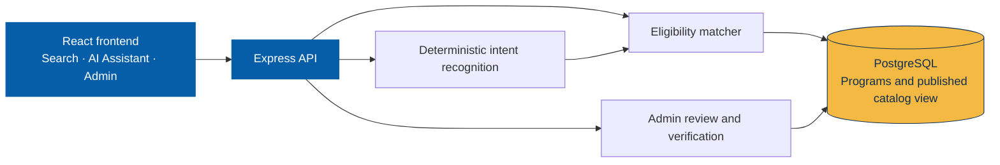

<p align="center">
  
</p>

<h1 align="center">BalaQoldau</h1>

<p align="center"><strong>Helping families in Kazakhstan find support for their children.</strong></p>

<p align="center">
  
  
  
  
</p>

<p align="center">
  <a href="#what-the-mvp-includes">Product</a> ·
  <a href="#architecture">Architecture</a> ·
  <a href="#local-setup">Local setup</a> ·
  <a href="#development-status">Status</a>
</p>

---

**Қазақша.** BalaQoldau Қазақстандағы ата-аналар мен қамқоршыларға балаларға арналған жәрдемақыларды, гранттарды, тегін курстар мен үйірмелерді табуға көмектеседі. Қазақша немесе орысша іздеп, қатысу шарттары мен ресми дереккөздерді бір жерден көре аласыз.

## Why BalaQoldau

Information about benefits and child support programs can be spread across government portals and program providers. Parents and caregivers in Kazakhstan need a single place to find relevant programs, understand which requirements apply to them, and reach the official source. BalaQoldau is an independent discovery tool. Program providers make eligibility and application decisions.

## What the MVP includes

| Capability | What users can do |
| --- | --- |
| **Program catalog** | Browse published government benefits, grants, free courses, and clubs. Open program details and follow official source links. |
| **Manual search** | Filter by region, child age, or program category at `/find`. Switch the interface between Kazakh and Russian. |
| **AI Assistant** | Ask a question in Kazakh or Russian at `/ai-assistant`. Review the matched programs or refine an ambiguous request. |
| **Eligibility explanations** | See why recorded criteria match, where they conflict, or what information is needed to assess a possible match. |
| **Admin and verification** | Authorized staff can draft, review, verify, publish, and request a source recheck. The public catalog excludes drafts, expired records, records flagged for source recheck, and DEMO entries. |

The AI Assistant uses **deterministic intent recognition and PostgreSQL matching**. It extracts supported age, region, category, and support-need cues and queries the verified catalog. It runs without a live generative AI model or an API key. [Assistant behavior and limitations](docs/AI_RECOMMENDATIONS.md)

## Architecture



| Layer | Technologies |
| --- | --- |
| Frontend | React, TypeScript, React Router, Vite, Tailwind CSS |
| Backend | Node.js, Express, TypeScript, Zod |
| Data | PostgreSQL, `pg`, SQL migrations |
| Quality | `node:test`, Chrome browser checks, GitHub Actions |

## Local setup

Use **Node.js 24.7 or newer**, npm, and **PostgreSQL 15 or newer**. Run the commands from the root of a checkout that contains the MVP source tree (`development`). In Windows PowerShell, use `npm.cmd` if script execution policy blocks `npm`.

1. Install the two packages.

   ```bash
   npm ci --prefix balaqoldau --ignore-scripts
   npm ci --prefix backend --ignore-scripts
   ```

2. Create a local PostgreSQL database and a login role that owns it. Copy [the backend environment example](backend/.env.example) to `backend/.env` if needed and set `DATABASE_URL` to that database. The [frontend environment example](balaqoldau/.env.example) is optional for the default local ports.

3. Build the backend and apply migrations to the local database.

   ```bash
   npm run build --prefix backend
   npm run db:migrate --prefix backend
   ```

4. Start the backend and frontend in separate terminals.

   ```bash
   npm run dev --prefix backend
   npm run dev --prefix balaqoldau
   ```

   Open `http://localhost:5173`. Vite proxies `/api` requests to the backend on port `3001`. A fresh database has reference data and an empty public catalog. To try searches with results, use the [admin setup guide](backend/README.md) and [program data checklist](PROGRAM_DATA_CHECKLIST.md) to publish a sourced record.

<details>
<summary>Verification commands</summary>

```bash
npm run typecheck --prefix balaqoldau
npm run lint --prefix balaqoldau
npm test --prefix balaqoldau
npm run build --prefix balaqoldau
npm test --prefix backend
```

For PostgreSQL integration tests, configure a separate `TEST_DATABASE_URL` as described in the [backend guide](backend/README.md), then run `npm run test:db --prefix backend`.

</details>

## Project structure

| Path | Purpose |
| --- | --- |
| [`balaqoldau/src/`](balaqoldau/src/) | Frontend, localized public pages, catalog assistant, and admin interface |
| [`backend/src/`](backend/src/) | Express API, eligibility matcher, and verification workflows |
| [`backend/migrations/`](backend/migrations/) | PostgreSQL schema and reference data migrations |
| [`docs/`](docs/) | Architecture, localization, security, and deployment guides |
| [`PROGRESS.md`](PROGRESS.md) | Implementation history and verification results |

## Development status

**MVP.** The core public discovery and admin verification flows are implemented and have been tested locally. The public launch is pending. Catalog coverage will grow as programs are sourced, reviewed, and published. [Project progress](PROGRESS.md) · [Release checklist](docs/RELEASE_CHECKLIST.md)

### Roadmap

- Populate the catalog with verified programs across more regions and track gaps in coverage.
- Pilot search with parents and caregivers in both languages and refine ambiguous-query handling from their feedback.
- Pilot an operator process for periodic source review and prepare the deployment for public launch.

## Team

BalaQoldau is maintained by the project contributors recorded in the repository history.
