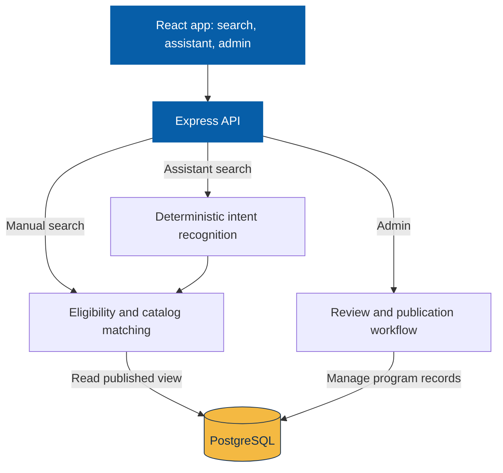

<p align="center">
  
</p>

<h1 align="center">BalaQoldau</h1>

<p align="center">
  <strong>Балаңызға қажет қолдауды табыңыз.</strong><br>
  Find the right support for your child.
</p>

<p align="center">
  
  
  
  
  
</p>

<p align="center"><strong>MVP · Active Development</strong></p>

<p align="center">
  <a href="#key-features">Features</a> ·
  <a href="#getting-started">Getting started</a> ·
  <a href="#roadmap">Roadmap</a> ·
  <a href="#documentation">Docs</a>
</p>

---

## About BalaQoldau

Families in Kazakhstan may need to check several government and program websites to find support, decode eligibility rules, and locate the right application page. BalaQoldau gives parents and caregivers one place to discover government benefits, grants, free courses, and children's activities, then follow the official source for the next step. The platform is independent. Program providers make eligibility and application decisions.

## Key features

| Feature | What it does |
| --- | --- |
| **Personalized program discovery** | Uses the criteria a family provides to explain matches and flag missing information. |
| **Age and region filtering** | Narrows manual search by child age, region, and program category. |
| **Kazakh and Russian localization** | Lets families browse and search in either language. |
| **AI-assisted catalog search** | Recognizes supported search cues and suggests matching published programs. |
| **Verified official information** | Shows recorded requirements and links to the official source on program pages. |
| **Admin verification workflow** | Lets authorized reviewers and administrators review sources, publish programs, and flag records for recheck. |

The AI Assistant uses **deterministic intent recognition and PostgreSQL matching**. It extracts supported cues such as age, region, category, and support need, then searches the catalog. It runs without a live generative model or an API key.

## How it works

1. **Describe what you need.** Use the filters at `/find` or ask a question in Kazakh or Russian at `/ai-assistant`.
2. **Review the matches.** See why a program fits the criteria you gave or what still needs to be checked.
3. **Open the official source.** Confirm the requirements, availability, and application process with the program provider.

## Technology stack

| Layer | Technologies |
| --- | --- |
| Frontend | React, TypeScript, React Router, Vite, Tailwind CSS |
| Backend | Node.js, Express, TypeScript, Zod |
| Database | PostgreSQL, `pg`, SQL migrations |
| Testing | `node:test`, PostgreSQL integration tests, Chrome browser checks, GitHub Actions |

## Architecture



## Getting started

Use **Node.js 24.7 or newer**, npm, and **PostgreSQL 15 or newer**. Run the commands from the repository root. In Windows PowerShell, use `npm.cmd` if script execution policy blocks `npm`.

1. Install the locked dependencies.

   ```bash
   npm ci --prefix balaqoldau --ignore-scripts
   npm ci --prefix backend --ignore-scripts
   ```

2. Create a local database and a login role that owns it. Copy [`backend/.env.example`](backend/.env.example) to `backend/.env` if needed and set `DATABASE_URL` to your local connection string. The [frontend environment example](balaqoldau/.env.example) is optional with the default ports.

3. Build the backend and apply the migrations.

   ```bash
   npm run build --prefix backend
   npm run db:migrate --prefix backend
   ```

4. Start the backend and frontend in separate terminals.

   ```bash
   npm run dev --prefix backend
   npm run dev --prefix balaqoldau
   ```

   Open [localhost:5173](http://localhost:5173). Vite forwards `/api` requests to the backend on port `3001`. A fresh database has reference data and an empty public catalog. Use the [backend setup guide](backend/README.md) and [program data checklist](PROGRAM_DATA_CHECKLIST.md) to configure admin access and publish a sourced program.

## Project structure

| Directory | Contents |
| --- | --- |
| [`balaqoldau/`](balaqoldau/) | React app, public assets, and frontend tests |
| [`backend/`](backend/) | Express API, eligibility matcher, migrations, and backend tests |
| [`docs/`](docs/) | Product and engineering guides |
| [`deploy/`](deploy/) | Example deployment configuration |
| [`scripts/`](scripts/) | Release and dependency verification tools |

## Development status

**Implemented.** Bilingual search, the catalog assistant, eligibility explanations, official source links, and the admin verification workflow are implemented and have been tested locally.

**Pending.** Verified program data entry, family usability testing, and public deployment are upcoming. [Development progress and test results](PROGRESS.md)

## Roadmap

1. **Populate the verified catalog** with sourced programs across the supported categories and close regional coverage gaps.
2. **Improve assistant recommendations** using tested Kazakh and Russian phrasing, clearer follow-up questions, and feedback on result relevance.
3. **Run usability sessions** with parents and caregivers in both languages.
4. **Prepare public deployment** by validating the production configuration, backup and restore, and the source recheck process.

## Documentation

| Area | Guides |
| --- | --- |
| **Development** | [Frontend and browser QA](balaqoldau/README.md) · [Backend setup](backend/README.md) · [Program API](backend/PROGRAM_API.md) |
| **Discovery** | [Catalog assistant](docs/AI_RECOMMENDATIONS.md) · [Eligibility matching](docs/MATCHING.md) · [Localization](docs/LOCALIZATION.md) |
| **Catalog operations** | [Verification workflow](backend/VERIFICATION.md) · [Reference data](backend/REFERENCE_DATA.md) · [Program data checklist](PROGRAM_DATA_CHECKLIST.md) |
| **Accounts and support** | [User authentication](backend/USER_AUTH.md) · [Profiles and saved programs](backend/USER_PROFILE.md) · [Child profiles](backend/CHILD_PROFILES.md) · [Contact API](backend/CONTACT_API.md) |
| **Release and security** | [Deployment](docs/DEPLOYMENT.md) · [Security](docs/SECURITY.md) · [Contact retention](docs/CONTACT_RETENTION.md) · [Release checklist](docs/RELEASE_CHECKLIST.md) |

## Team

BalaQoldau is developed by a two-person team.
