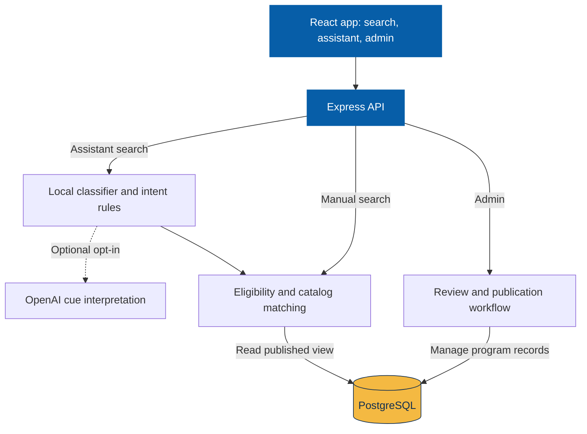

<p align="center">
  
</p>

<h1 align="center">BalaQoldau</h1>

<p align="center">
  <strong>Балаңызға қажет қолдауды табыңыз.</strong><br>
  Find the right support for your child.
</p>

<p align="center">
  
  
  
  
  
</p>

<p align="center"><strong>MVP · Active Development</strong></p>

<p align="center">
  <a href="#key-features">Features</a> ·
  <a href="#getting-started">Getting started</a> ·
  <a href="#roadmap">Roadmap</a> ·
  <a href="#documentation">Docs</a>
</p>

---

## About BalaQoldau

**Қазақша.** BalaQoldau Қазақстандағы ата-аналар мен қамқоршыларға балаларға арналған жәрдемақыларды, гранттарды, тегін курстар мен үйірмелерді бір жерден табуға көмектеседі. Баланың жасы мен өңірі бойынша іздеп, қатысу шарттарын ресми дереккөзден тексеруге болады.

Families in Kazakhstan may need to check several government and program websites to find support, decode eligibility rules, and locate the right application page. BalaQoldau gives parents and caregivers one place to discover government benefits, grants, free courses, and children's activities, then follow the official source for the next step. The platform is independent. Program providers make eligibility and application decisions.

## Key features

| Feature | What it does |
| --- | --- |
| **Personalized program discovery** | Uses the criteria a family provides to explain matches and flag missing information. |
| **Age and region filtering** | Narrows manual search by child age, region, and program category. |
| **Kazakh and Russian localization** | Lets families browse and search in either language. |
| **AI-assisted catalog search** | Recognizes supported search cues and suggests matching published programs. |
| **Verified official information** | Shows recorded requirements and links to the official source on program pages. |
| **Admin verification workflow** | Lets authorized reviewers and administrators review sources, publish programs, and flag records for recheck. |

The AI Assistant uses a **local bilingual classifier, intent rules, and PostgreSQL matching**. It works without an API key. An optional backend OpenAI integration can assist opted-in turns using allowlisted search cues. The catalog and matcher supply the program facts and eligibility explanations.

## How it works

1. **Describe what you need.** Use the filters at `/find` or ask a question in Kazakh or Russian at `/ai-assistant`.
2. **Review the matches.** See why a program fits the criteria you gave or what still needs to be checked.
3. **Open the official source.** Confirm the requirements, availability, and application process with the program provider.

## Technology stack

| Layer | Technologies |
| --- | --- |
| Frontend | React, TypeScript, React Router, Vite, Tailwind CSS |
| Backend | Node.js, Express, TypeScript, Zod |
| Database | PostgreSQL, `pg`, SQL migrations |
| Testing | `node:test`, PostgreSQL integration tests, Chrome browser checks, GitHub Actions |

## Architecture



## Getting started

Run the commands from the repository root in Windows PowerShell. Clone a revision that contains `compose.yaml` and `db:seed:judge`.

```powershell
git clone https://github.com/zhkaznel7/BalaQoldau.git
Set-Location BalaQoldau
```

### Docker Desktop for Windows

Start Docker Desktop in Linux container mode and wait for the engine. This route includes Node.js and PostgreSQL in containers. It requires access to Docker Hub and the npm registry on the first build.

```powershell
docker version
docker compose version
docker compose up --build --detach --wait
docker compose exec api npm run db:seed:judge
Invoke-RestMethod http://127.0.0.1:8080/api/ready
Start-Process 'http://127.0.0.1:8080/ai-assistant?lang=kk'
```

The API applies migrations on startup. The seed is optional and the catalog starts empty until you run it. The web port binds only to loopback. PostgreSQL uses trust authentication on a private Docker network with no host port. Keep this stack local. Docker Compose does not load your backend `.env`. No OpenAI key is required.

```powershell
docker compose ps
docker compose logs judge-db api web
docker compose down
```

`down` keeps the judge database volume. To deliberately erase the local judge database and all its contents, use `docker compose down --volumes`.

### Native Windows PowerShell

Install Git, **Node.js 24.7 or newer** with npm, and **PostgreSQL 15 or newer**. Start the PostgreSQL service on loopback port 5432. The commands below assume PostgreSQL 18 in its default installation directory. Adjust `$pgBin` to your installed version.

```powershell
node --version
npm.cmd --version
npm.cmd ci --prefix balaqoldau --ignore-scripts
npm.cmd ci --prefix backend --ignore-scripts

$pgBin = 'C:\Program Files\PostgreSQL\18\bin'
if (Test-Path backend/.env) { throw 'Use a fresh clone or configure the existing backend/.env manually.' }
& "$pgBin\createuser.exe" -h 127.0.0.1 -U postgres -P balaqoldau_judge
if ($LASTEXITCODE) { throw 'Could not create the judge login.' }
& "$pgBin\createdb.exe" -h 127.0.0.1 -U postgres -O balaqoldau_judge balaqoldau_judge
if ($LASTEXITCODE) { throw 'Could not create the judge database.' }
& "$pgBin\psql.exe" -h 127.0.0.1 -U postgres -d balaqoldau_judge -v ON_ERROR_STOP=1 -f deploy/judge-db-init.sql
if ($LASTEXITCODE) { throw 'Could not mark the judge database.' }

Copy-Item backend/.env.example backend/.env
$secret = Read-Host 'Enter the password you chose for the judge login' -AsSecureString
$encoded = [Uri]::EscapeDataString([System.Net.NetworkCredential]::new('', $secret).Password)
Add-Content backend/.env ('DATABASE_URL=postgresql://balaqoldau_judge:' + $encoded + '@127.0.0.1:5432/balaqoldau_judge')
Remove-Variable secret, encoded

npm.cmd run build --prefix backend
npm.cmd run db:migrate --prefix backend
npm.cmd run db:seed:judge --prefix backend
```

Run the backend and frontend in separate PowerShell terminals from the repository root.

```powershell
# Terminal 1
npm.cmd run dev --prefix backend
```

```powershell
# Terminal 2
npm.cmd run dev --prefix balaqoldau
```

Open [localhost:5173](http://localhost:5173). Vite proxies `/api` to port 3001. Check readiness with `Invoke-RestMethod http://localhost:5173/api/ready`. Admin and account authentication are opt-in. See the [backend setup guide](backend/README.md) for those flows.

### Try the keyless assistant

Open `/ai-assistant?lang=kk` or `/ai-assistant?lang=ru`. Select the local catalog consent and leave the separate OpenAI opt-in unchecked. Try `Астанада 0 жастағы балаға қандай жәрдемақы бар?` or `Какие пособия есть в Астане для ребёнка 0 лет?`. After seeding, the two examples appear as possible matches with an official source link.

The judge seed loads two eGov-sourced benefits into a fresh, marked `balaqoldau_judge` database only. It runs transactionally, refuses production and other database names, and reports zero inserts on repeat. It records the source review date of 23 November 2026, and keeps eligibility incomplete. The examples exercise published catalog discovery without creating staff approval history. They are separate from `db:seed`, which creates hidden demo drafts. After the assistant's normal 180-day review window, the examples remain browsable but require a fresh source review to reappear in recommendations. [Official eGov guidance](https://egov.kz/cms/kk/articles/child/ui_decret)

### Checks and troubleshooting

```powershell
npm.cmd test --prefix backend
npm.cmd test --prefix balaqoldau
npm.cmd run build --prefix backend
npm.cmd run build --prefix balaqoldau
node scripts/check-release.mjs --source
node scripts/check-release.mjs --artifacts
```

For PostgreSQL integration tests, use disposable databases separate from the judge catalog. Set `TEST_DATABASE_URL` to `balaqoldau_test` and, when running outside GitHub Actions, also set `DATABASE_URL` to a local `balaqoldau_dev`. A workflow test checks that name before it connects. The full suite exercises PostgreSQL roles as well as application queries. See the [backend test setup](backend/README.md).

| Symptom | Check |
| --- | --- |
| Docker cannot reach the engine | Start Docker Desktop, enable Linux containers, and check `docker version` shows a Server section. |
| Port 8080 is occupied | Set `$env:JUDGE_WEB_PORT = '8081'` in the Compose terminal and use port 8081 in the browser. |
| Vite selected port 5174 | Free port 5173 and restart Vite, or explicitly allow the new origin in `backend/.env`. |
| API readiness is 503 | Check the PostgreSQL service, database URL, and migration output. For Compose, inspect `docker compose logs judge-db api`. |
| Judge seed refused | Verify that the database is a fresh local `balaqoldau_judge`, has the judge marker, and has had all migrations applied. The seed refuses a catalog containing other records. |
| Catalog is empty | Run the judge seed for the setup you are using. The standard demo seed creates drafts outside the public catalog. |

## Project structure

| Directory | Contents |
| --- | --- |
| [`balaqoldau/`](balaqoldau/) | React app, public assets, and frontend tests |
| [`backend/`](backend/) | Express API, eligibility matcher, migrations, and backend tests |
| [`docs/`](docs/) | Product and engineering guides |
| [`deploy/`](deploy/) | Example deployment configuration |
| [`scripts/`](scripts/) | Release and dependency verification tools |

## Development status

**Implemented.** Bilingual search, the catalog assistant, eligibility explanations, official source links, and the admin verification workflow are implemented and have been tested locally.

**Pending.** Verified program data entry, family usability testing, and public deployment are upcoming. [Development progress and test results](PROGRESS.md)

## Roadmap

1. **Populate the verified catalog** with sourced programs across the supported categories and close regional coverage gaps.
2. **Improve assistant recommendations** using tested Kazakh and Russian phrasing, clearer follow-up questions, and feedback on result relevance.
3. **Run usability sessions** with parents and caregivers in both languages.
4. **Prepare public deployment** by validating the production configuration, backup and restore, and the source recheck process.

## Documentation

- **Development**

  [Frontend and browser QA](balaqoldau/README.md) · [Backend setup](backend/README.md) · [Program API](backend/PROGRAM_API.md)
- **Discovery**

  [Catalog assistant](docs/AI_RECOMMENDATIONS.md) · [Eligibility matching](docs/MATCHING.md) · [Localization](docs/LOCALIZATION.md)
- **Catalog operations**

  [Verification workflow](backend/VERIFICATION.md) · [Reference data](backend/REFERENCE_DATA.md) · [Program data checklist](PROGRAM_DATA_CHECKLIST.md)
- **Accounts and support**

  [User authentication](backend/USER_AUTH.md) · [Profiles and saved programs](backend/USER_PROFILE.md) · [Child profiles](backend/CHILD_PROFILES.md) · [Contact API](backend/CONTACT_API.md)
- **Release and security**

  [Deployment](docs/DEPLOYMENT.md) · [Security](docs/SECURITY.md) · [Contact retention](docs/CONTACT_RETENTION.md) · [Release checklist](docs/RELEASE_CHECKLIST.md)

## Team

BalaQoldau is developed by a two-person team.
